  

  
  
  
  

---

## What we build

Codic Systems builds the software a business runs on: AI agents and workflow automation, booking and reservation platforms, operations and back office systems, and the integrations that connect them.

Our founder's background is mostly travel software, which is why most of our open source work comes from there. He has also built systems in healthcare, education, real estate and finance.

<table>
<tr>
<td width="33%" valign="top">

### AI agents and automation
Agents that read an enquiry, pull out what matters, draft the reply and escalate what a person should see. The model reads and drafts. A human owns any decision that involves money or bookings.

</td>
<td width="33%" valign="top">

### Booking and operations systems
Enquiry through to confirmation, plus the back office a business actually runs on: documents, invoicing, signatures and reporting.

</td>
<td width="33%" valign="top">

### Integrations and rescue
Payment gateways, WhatsApp Business API, suppliers and accounting. And taking over a system nobody currently understands, then documenting it and making it safe to change.

</td>
</tr>
</table>

---

## What's here

The client systems we build are private. What we publish is the part that is useful to everyone else: tools, templates and reference material from real work.

| Repository | What it is |
|---|---|
| **[travel-whatsapp-booking-bot](https://github.com/codicsystems/travel-whatsapp-booking-bot)** | An n8n workflow that reads inbound WhatsApp enquiries, extracts what a consultant needs, replies to fill the gaps, and hands anything complex to a person. Verifies Meta's webhook signature, the step most tutorials skip and the one that stops strangers sending messages in your company's name. |
| **[pk-it-export-toolkit](https://github.com/codicsystems/pk-it-export-toolkit)** | Templates and checklists for Pakistani companies invoicing clients abroad. Invoice template, purpose code declaration, board resolution, agreement heads of terms, and the paperwork that decides how your export income is taxed. |
| **[redmoon-pdf](https://github.com/codicsystems/redmoon-pdf)** | Compress a PDF to an exact target size, in the browser. No upload, no server. Binary search over quality and resolution, and it tells you honestly when the result would be worse than your original. |
| **[travel-tech-learning-path](https://github.com/codicsystems/travel-tech-learning-path)** | How booking and operations systems actually work, written for engineers about to build one. What a booking really is, where the money moves, and the failure modes that show up at 2am in month nine. |

---

<b>How we work</b>

 

- **Scoped in writing before any code**, with an explicit list of what is *not* included
- **Architecture decision records**, one page per significant choice: what was decided, what was considered, why
- **Weekly increments you can open and click**, not a status report
- **Tested where being wrong costs money**, meaning anything touching payments or bookings
- **A human review pass on every AI-generated module** for security boundaries, error handling, and anything the model may have invented
- **Handed over properly** with README, environment setup, deployment steps, credentials, architecture diagram and known limitations

Fixed price against a defined outcome. We do not bill hours.

Codic Systems is run by one engineer, Lal Chand, so you speak to the person building your system, not an account manager.

<b>Who we are not for</b>

 

Brochure websites, template work and WordPress theme customisation. That market has been commoditised and we are not competing for it.

We will also tell you what not to build. Some of what people ask us for is not worth doing, and saying so early is cheaper for everyone than finding out in month four.

<b>Verify us</b>

 

| | |
|---|---|
| **Registered name** | CODIC SYSTEMS (SMC-PRIVATE) LIMITED |
| **CUIN** | 0352637, incorporated 27 August 2026, CRO Islamabad |
| **NTN** | J778998, active filer |
| **PSEB** | Z-25-21973/26, registered IT exporter |
| **Registered office** | Islamabad Capital Territory, Pakistan |

Search **CODIC SYSTEMS** on the [SECP company register](https://eservices.secp.gov.pk/eServices/NameSearch.jsp). We would rather you checked.

---

## Get in touch

Something to build, or a system that needs rescuing?

**[codicsystems.com](https://codicsystems.com)** · info@codicsystems.com

  

